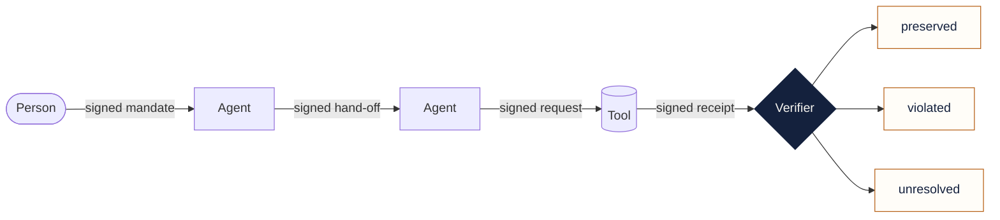

<picture>
  <source media="(prefers-color-scheme: dark)" srcset="assets/banner-dark.svg">
  <source media="(prefers-color-scheme: light)" srcset="assets/banner-light.svg">
  
</picture>

<p align="center">
  <a href="https://datatracker.ietf.org/doc/draft-stafordtituss-agentic-mandate-evidence/"></a>
  <a href="https://pypi.org/project/amep-protocol/"></a>
  <a href="https://www.npmjs.com/package/@stafordtituss/amep"></a>
  <a href="https://github.com/stafordtituss/amep/tree/main/vectors"></a>
  <a href="https://github.com/stafordtituss/amep/blob/main/LIMITS.md"></a>
</p>

<br>

When an AI agent acts for someone, it often hands work to another agent, which calls a tool. Each step can look fine on its own, and the action at the end can still be one nobody allowed.

I build **[AMEP](https://github.com/stafordtituss/amep)**, the Agentic Mandate Evidence Protocol. Every hand-off and every action leaves a signed record, and anyone holding them can check afterwards whether the action stayed within the authority it was given. There are three possible answers, and a missing record is never read as "fine":

<table>
  <tr>
    <td width="33%" valign="top"><b>Preserved</b><br><sub>What happened stayed inside what was allowed.</sub></td>
    <td width="33%" valign="top"><b>Violated</b><br><sub>It went outside, and the answer names who departed first.</sub></td>
    <td width="33%" valign="top"><b>Unresolved</b><br><sub>A record is missing, and the answer names which one.</sub></td>
  </tr>
</table>



### Work with other projects

| Where | What happened |
|---|---|
| **Google Agent Payments Protocol** | Found that AP2's specification and SDK computed receipt references differently ([#405](https://github.com/google-agentic-commerce/AP2/issues/405)); the specification fix is proposed in [#406](https://github.com/google-agentic-commerce/AP2/pull/406). |
| **Verifiable Agent Trust Envelope** | Two AMEP evaluations of its recovery cases, re-run by its maintainer and merged ([#138](https://github.com/Poke-nushi/Verifiable-Agent-Trust-Envelope/pull/138), [#139](https://github.com/Poke-nushi/Verifiable-Agent-Trust-Envelope/pull/139)). |
| **in-toto** | A proposed attestation predicate for signed verdicts ([in-toto/attestation#625](https://github.com/in-toto/attestation/pull/625)). |
| **W3C Agent Identity Registry Protocol CG** | A delegation use case with 20 test cases. |

### Try it

```bash
pip install amep-protocol          # Python
npm install @stafordtituss/amep    # JavaScript
```

What it can't show is written down too, each limit with a test: **[LIMITS.md](https://github.com/stafordtituss/amep/blob/main/LIMITS.md)**.

<br>

<p align="center">
  <sub>
    Reviews and independent implementations are welcome:
    <a href="https://github.com/stafordtituss/amep/issues">open an issue</a>
    or see <a href="https://github.com/stafordtituss/amep/issues/18">#18</a>.
  </sub>
</p>
